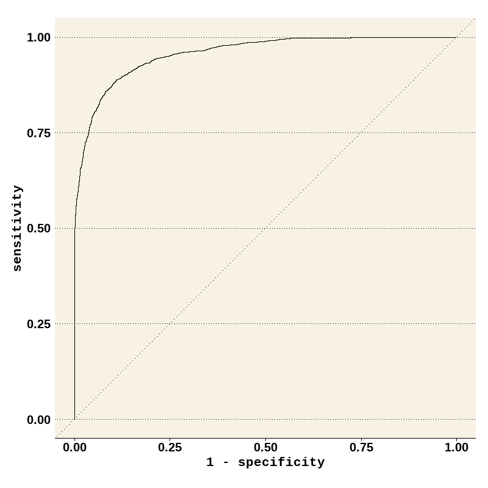
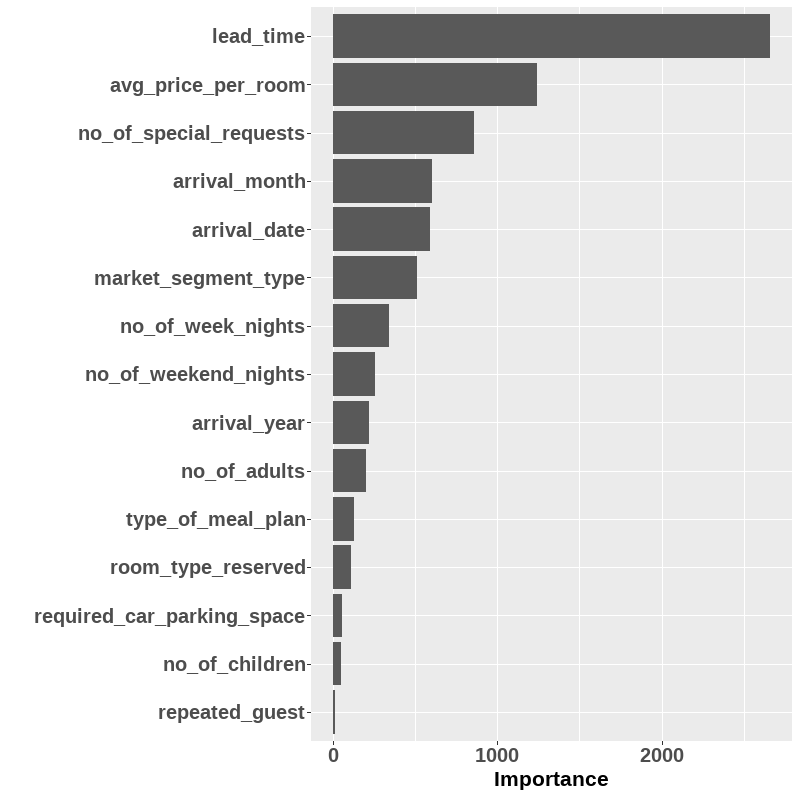

# Hotel Cancellation Prediction

[](https://github.com/izzydi/hotel-cancellation-prediction/actions/workflows/ci.yml)

An applied machine-learning project focused on identifying booking characteristics associated with hotel cancellations and connecting those patterns to practical revenue-protection decisions.

## Primary workflow

[`src/hotel_cancellation_model.py`](src/hotel_cancellation_model.py) is the audited implementation. It creates a stratified hold-out set, excludes common booking/reservation identifier fields, automatically separates numeric and categorical predictors, and places imputation, one-hot encoding and scaling inside scikit-learn pipelines so learned preprocessing remains inside cross-validation folds.

The script tunes a balanced Logistic Regression baseline and a balanced Random Forest on training data only, then reports accuracy, balanced accuracy and weighted F1 on the untouched test set. Metrics and the list of excluded predictor columns are written to `outputs/metrics.json`.

## Results (original R notebook)

The exact modified CSV is not in the repository, so the current Python script has not been re-run on it. The results below are the saved outputs of the original R/tidymodels analysis preserved in [`archive/hotel_cancellation_modeling.ipynb`](archive/hotel_cancellation_modeling.ipynb):

- 27,511 bookings after removing rows with missing values (32.8% cancelled).
- 75/25 stratified train/test split.
- Hyperparameters tuned on an 80/20 validation split of the training data.
- Preprocessing kept inside tidymodels recipes.
- Test set (6,879 bookings) used once, for the final fit.

| Model | Validation ROC AUC | Test ROC AUC | Test accuracy |
|---|---|---|---|
| Penalised logistic regression (lasso) | 0.861 | – | – |
| XGBoost | 0.942 | – | – |
| **Random Forest** (`mtry = 5`, `min_n = 7`, 1,000 trees) | **0.945** | **0.957** | **0.900** |

For reference, always predicting "not cancelled" gives 0.672 accuracy. Validation and test ROC AUC are close, so the validation-based model choice held up on unseen data. The strongest predictors were lead time, average room price, number of special requests, arrival month and date, and market segment.

<p align="center">
  
  
</p>

These figures are the original notebook outputs, unchanged. When the exact CSV is available again, this section should be replaced with the output of `src/hotel_cancellation_model.py`.

## Leakage safeguards

- The target is removed before predictor processing.
- Common identifiers such as `Booking_ID`, reservation IDs and booking-reference fields are excluded automatically.
- Dataset-specific fields that would not be available at prediction time can be excluded explicitly with repeated `--drop-column` arguments.
- Learned preprocessing stays inside each cross-validation fold.
- The final held-out test set is not used for tuning.

## Repository structure

- [`src/hotel_cancellation_model.py`](src/hotel_cancellation_model.py) — audited modelling pipeline.
- [`tests/test_smoke.py`](tests/test_smoke.py) — lightweight schema/guard tests.
- [`.github/workflows/ci.yml`](.github/workflows/ci.yml) — Python 3.12 CI.
- [`data/README.md`](data/README.md) — expected dataset layout and provenance limitations.
- [`requirements.txt`](requirements.txt) — pinned direct Python dependencies.
- [`archive/hotel_cancellation_modeling.ipynb`](archive/hotel_cancellation_modeling.ipynb) — original exploratory notebook retained for provenance.
- [`figures/`](figures/) — ROC curve and variable importance exported unchanged from the original notebook.

## Dataset

The historical project was based on a Hotel Reservations Classification exercise whose data were modified. The exact modified CSV and transformation history are not available in the repository, so the project does not claim that an arbitrary public dataset with a similar name reproduces the original exercise. See [`data/README.md`](data/README.md).

## Run locally

The pinned environment is tested in CI with Python 3.12.

```bash
python -m venv .venv
# Windows: .venv\Scripts\activate
# macOS/Linux: source .venv/bin/activate
pip install -r requirements.txt
python src/hotel_cancellation_model.py
```

If the booking-status column cannot be inferred automatically:

```bash
python src/hotel_cancellation_model.py --target Booking_Status
```

To exclude a dataset-specific field that is an identifier or would not be known at prediction time:

```bash
python src/hotel_cancellation_model.py --drop-column some_field --drop-column another_field
```

## Scope

This is an applied portfolio project demonstrating leakage-aware classification around a hospitality business problem. It is not a deployed cancellation-scoring service.
